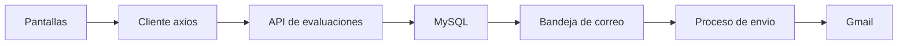

# Guía de conexión — Evaluación de Desempeño

Este archivo es para la persona que va a conectar las pantallas reales del módulo de Evaluación de Desempeño con el backend que ya está construido.

Hoy esas pantallas viven en `hr360-checkin-frontend` y leen datos de prueba del navegador (`localStorage`, prefijo `adamia:desempeno:demo:v1`). La lógica de esa demostración está en:

- `hr360-checkin-frontend/src/lib/evaluaciones/demoStore.mjs`
- `hr360-checkin-frontend/src/lib/evaluaciones/model.mjs`

El backend real está en `hr360-checkin-backend/modules/performance`. Las fases 1 a 7 ya están implementadas y probadas. Este documento describe esa API tal como quedó, no un diseño futuro. Si en algún momento el código y este archivo no coinciden, manda el código.

No hace falta rediseñar las pantallas. El trabajo es cambiar de dónde salen los datos: en lugar de `demoStore.mjs`, las mismas pantallas deben llamar a los endpoints de abajo. Las reglas de preguntas, puntaje, semáforo y CSV del demo ya están repetidas en el servidor.

## Por dónde empezar

1. Confirmar que el login existente (`POST /api/users/login`) ya entrega un JWT y que el cliente HTTP del proyecto apunta a `NEXT_PUBLIC_RUTA_BACKEND`.
2. Al entrar al módulo, llamar `GET /api/checador/evaluaciones-desempeno/capabilities`. Con esa respuesta se sabe el perfil, las pestañas permitidas y los límites de texto.
3. Sustituir cada acción del demo (`template.save`, `campaign.launch`, `response.submit`, y el resto) por el endpoint de la sección 7. El índice de abajo dice en qué apartado está cada una.
4. En cada edición, devolver el número de versión que trajo el detalle. La tabla de la sección 5 dice cómo se llama ese número en cada recurso.
5. En lanzar, enviar, publicar y recordar, mandar un `Idempotency-Key` nuevo por cada clic. Los tres ejemplos completos están en la sección 6.
6. No migrar al servidor las personas ficticias del demo. Una empresa real empieza sin campañas ni plantillas de prueba.

## Índice

1. [Qué entra en esta conexión y qué no](#1-qué-entra-en-esta-conexión-y-qué-no)
2. [Cómo viaja una petición](#2-cómo-viaja-una-petición)
3. [Autenticación, ruta base y empresa](#3-autenticación-ruta-base-y-empresa)
4. [Perfil de quien entra](#4-perfil-de-quien-entra)
5. [Respuestas, errores y versiones](#5-respuestas-errores-y-versiones)
6. [Ejemplos completos de petición](#6-ejemplos-completos-de-petición)
7. [Pantalla por pantalla](#7-pantalla-por-pantalla)
8. [Qué ya no hay que simular](#8-qué-ya-no-hay-que-simular)
9. [Antes de apuntar esto a producción](#9-antes-de-apuntar-esto-a-producción)

## 1. Qué entra en esta conexión y qué no

Entra:

1. Dejar de leer `demoStore.mjs` y `seedState()`.
2. Llamar la API de este documento desde las pantallas que ya existen.
3. Quitar los datos de demostración para que una empresa real no herede campañas ficticias.

No existe en el backend y no hay que inventarlo en el cliente:

- Exportar a PDF. Solo hay CSV.
- Subir archivos privados. La evidencia de un plan es un enlace `https://...`.
- Una bitácora general (`GET /audit`).
- Firma OTP o firma de un proveedor externo. El acuse es un texto fijo del servidor más el nombre que escribe la persona. Ver la sección 7.8.

## 2. Cómo viaja una petición

El frontend no envía correos. Guarda el aviso en la misma operación que lanza la campaña o publica el resultado. Un proceso aparte, ya existente en el backend, lee esa bandeja y manda el correo con Gmail.



## 3. Autenticación, ruta base y empresa

No hay un login nuevo. Se usa el login del resto del sistema:

```http
POST /api/users/login
Content-Type: application/json

{ "correo": "...", "contrasenia": "..." }
```

La respuesta trae `token`, `tipo_usuario` y `esEmpleado`. Todas las llamadas de este módulo llevan:

```http
Authorization: Bearer <token>
```

La base de la URL es la variable `NEXT_PUBLIC_RUTA_BACKEND`, la misma que ya usa `@/lib/axios` en los otros módulos. No hace falta un cliente HTTP distinto. El prefijo de este módulo, pegado a esa base, es:

```text
/api/checador/evaluaciones-desempeno
```

No es `/api/v1/performance`. Se usó el estilo en español del resto del backend.

Todas las rutas necesitan saber la empresa. Se puede mandar `?empresa=4` o `?id_empresa=4`. Si no se manda, el servidor usa la empresa del token. Esas reglas ya están en el servidor:

- Un admin de panel puede pedir cualquier empresa.
- Un empleado solo puede pedir la suya. Si pide otra, responde 403 `EMPRESA_FUERA_DE_ALCANCE`.
- Un usuario de panel que no es admin solo puede pedir las empresas que ya vienen en su token.

En los ejemplos de abajo, `empresa=4` es solo un número de muestra.

## 4. Perfil de quien entra

El frontend no elige el perfil. El servidor lo calcula en cada petición y lo devuelve aquí:

```http
GET /api/checador/evaluaciones-desempeno/capabilities?empresa=4
Authorization: Bearer <token>
```

```json
{
  "data": {
    "profile": "hr",
    "companyId": 4,
    "employeeId": null,
    "userId": 1,
    "scopes": ["templates", "catalogs", "levels", "people", "settings", "permissions", "campaigns", "assignments", "team", "results", "dashboard", "plans"],
    "flags": {
      "canManageTemplates": true,
      "canManageCampaigns": true,
      "canPublishResults": true,
      "canViewDashboard": true
    },
    "grants": ["rh"],
    "settings": { "employeeScore": true },
    "settingsRevision": 1,
    "limits": { "templateName": 160, "comment": 4000 }
  },
  "requestId": "..."
}
```

Hay que llamar esto al abrir el módulo. `profile` reemplaza el `actor.role` que el demo armaba a mano. `scopes` dice qué pestañas mostrar. `limits` y `settings` reemplazan las constantes locales del demo: el servidor es quien manda.

| Perfil | Cuándo lo asigna el servidor |
| --- | --- |
| `hr` | Usuario de panel Admin, Recruiter o User, o un permiso explícito de perfil `rh` |
| `direction` | Permiso explícito de perfil `direccion`. No existe un rol nativo de Dirección en el resto del sistema |
| `manager` | Empleado con al menos un reporte directo activo |
| `employee` | Cualquier otro empleado |

El orden de privilegio es `hr`, luego `direction`, luego `manager`, luego `employee`. Una persona no acumula dos perfiles a la vez.

## 5. Respuestas, errores y versiones

Una respuesta correcta trae `data` y `requestId`. Un listado agrega paginación:

```json
{
  "data": [],
  "pagination": { "page": 1, "pageSize": 25, "total": 42 },
  "aggregates": {},
  "requestId": "..."
}
```

`page` empieza en 1. `pageSize` va de 1 a 100 y, si no se manda, vale 25.

Un error siempre tiene esta forma. `message` ya está en español y se puede mostrar tal cual:

```json
{
  "error": {
    "code": "VALIDACION",
    "message": "Escribe el nombre de la campaña.",
    "fields": [{ "path": "name", "message": "Escribe el nombre de la campaña." }],
    "requestId": "..."
  }
}
```

Códigos que salen seguido:

| HTTP | Código | Cuándo |
| --- | --- | --- |
| 422 | `VALIDACION` | Falta un dato o el dato no sirve |
| 404 | `NO_ENCONTRADO` | No existe, o el perfil no debe verlo |
| 403 | `PROHIBIDO` | El perfil no puede hacer esa acción |
| 409 | `VERSION` | Alguien más guardó primero. Hay que recargar |
| 409 | `FUERA_DE_PERIODO` | La campaña no está abierta para responder |
| 429 | `LIMITE_RECORDATORIOS` | Ya se pidió un recordatorio de esa campaña hace menos de una hora |

### Número de versión al editar

El demo tenía un solo `revision` para todo el estado. Aquí cada recurso tiene el suyo. Al guardar hay que devolver el número que trajo el detalle. Se manda en el cuerpo como `version` o en el header `If-Match`. Las dos formas valen. Si otra persona guardó antes, la respuesta es 409 `VERSION` y el texto ya dice que hay que recargar.

| Recurso | El detalle lo llama | Al guardar se manda |
| --- | --- | --- |
| Plantilla | `revision` | `version` en el cuerpo, o `If-Match` |
| Campaña, asignaciones, ampliar y cerrar | `revision` | `version` en el cuerpo, o `If-Match` |
| Borrador y envío de una respuesta | `revision` | `version` en el cuerpo, o `If-Match` |
| Plan | `revision` | `version` en el cuerpo, o `If-Match` |
| Configuración global (`/settings`) | `version` | `version` en el cuerpo, o `If-Match` |

La configuración es el único caso en el que el detalle ya se llama `version`. En los demás, el detalle dice `revision` y al guardar ese mismo número viaja con el nombre `version`.

### Clave para no repetir una acción

Lanzar una campaña, enviar una respuesta, publicar un resultado y pedir un recordatorio exigen este header:

```http
Idempotency-Key: <texto único, máximo 200 caracteres>
```

Hay que generar un identificador nuevo por cada clic, no uno fijo por sesión. En lanzar, enviar y publicar, si la red reintenta con la misma clave, el servidor no repite la acción y responde `replayed: true`. Si esa acción ya se completó y se manda otra clave, responde 409. El recordatorio también exige la clave, pero un segundo intento antes de una hora responde 429 `LIMITE_RECORDATORIOS`.

## 6. Ejemplos completos de petición

La base es `{NEXT_PUBLIC_RUTA_BACKEND}/api/checador/evaluaciones-desempeno`.

Lanzar una campaña que ya tiene asignaciones guardadas:

```http
POST /api/checador/evaluaciones-desempeno/campaigns/7/launch?empresa=4
Authorization: Bearer <token>
Idempotency-Key: 6f1c0e3a-1b2d-4c55-9a10-0c2e8b7d4f11
```

Enviar una evaluación. `version` es el `revision` que devolvió `GET /assignments/15`:

```http
POST /api/checador/evaluaciones-desempeno/assignments/15/submit?empresa=4
Authorization: Bearer <token>
Content-Type: application/json
If-Match: 2
Idempotency-Key: 9a44e2b1-77c0-4d18-8e55-31aa0c9b2210

{
  "version": 2,
  "answers": { "pregunta-1": 4 },
  "comment": "Cumple los acuerdos del periodo.",
  "privateNote": "",
  "categoryComments": {}
}
```

Publicar un resultado ya aprobado, cuando la campaña pide aprobación:

```http
POST /api/checador/evaluaciones-desempeno/campaigns/7/results/292/publish?empresa=4
Authorization: Bearer <token>
Idempotency-Key: c31d8a70-5e44-4b19-90af-18d2bb6610de
```

Basta con uno de los dos, `If-Match` o `version`. En el ejemplo del envío aparecen los dos para mostrar las formas válidas.

## 7. Pantalla por pantalla

Las rutas de esta sección ya incluyen el prefijo del módulo. Siempre van después de `NEXT_PUBLIC_RUTA_BACKEND` y llevan `Authorization` y `empresa`.

### 7.1 Catálogos, niveles y permisos

```http
GET /catalogs?empresa=4
```

Responde `{ areas, positions, branches, levels: [{ id, name, order }], timezone }`. Áreas, puestos y sucursales salen de los catálogos reales de la empresa, no de una lista escrita en el demo.

Los niveles jerárquicos son un catálogo de RH. La tabla de empleados no tiene una columna de nivel:

```http
GET /levels
POST /levels
{ "nombre": "Operativo", "orden": 3 }

PATCH /levels/1
{ "nombre": "Operativo", "orden": 3 }

DELETE /levels/1
PUT /people/292/level
{ "levelId": 1 }
```

`DELETE` responde 409 `NIVEL_EN_USO` si todavía hay personas en ese nivel. `levelId: null` quita el nivel de esa persona.

Permisos de RH y Dirección:

```http
GET /permissions
POST /permissions
{ "perfil": "rh", "idUsuario": 1 }

DELETE /permissions/3
```

`perfil` solo acepta `rh` o `direccion`. En el alta se manda `idUsuario` o `idEmpleado`, nunca los dos.

### 7.2 Personas

```http
GET /people?empresa=4&q=&areaId=&positionId=&managerId=&page=1&pageSize=25&sort=name
```

`sort` acepta `name`, `area` o `position`. Cada persona trae `id`, `name`, `area`, `position`, `managerId` y `active`. El servidor ya omite CURP, NSS y contraseña.

```http
GET /people/292/history
```

Devuelve el historial de resultados publicados de esa persona. Si el perfil no puede verlo, la respuesta es 404.

### 7.3 Plantillas

```http
GET /templates?empresa=4&q=&archived=active&page=1&pageSize=25
GET /templates/8
GET /templates/8?version=2
POST /templates
POST /templates/8/versions
POST /templates/8/duplicate
PATCH /templates/8/archive
```

`archived` acepta `active`, `archived` o `all`. Sin `version`, el detalle trae la última. Crear una versión, duplicar y archivar necesitan el `revision` del detalle. Archivar manda `{ "archived": true }` o `{ "archived": false }`.

Cuerpo para crear la plantilla o una versión nueva:

```json
{
  "name": "Evaluación general",
  "description": "Competencias del trimestre.",
  "areaId": null,
  "positionId": null,
  "scale": [
    { "label": "Muy bajo", "description": "Rendimiento no aceptable" }
  ],
  "bands": [
    { "label": "Requiere seguimiento", "min": 1, "max": 2.99, "color": "red" }
  ],
  "categories": [
    {
      "name": "Resultados",
      "weight": 100,
      "questionWeights": "equal",
      "questions": [
        {
          "text": "Termina su trabajo oportunamente",
          "type": "scale",
          "required": true,
          "scored": true,
          "weight": 1,
          "min": 0,
          "max": 10,
          "yesScore": 5,
          "noScore": 1,
          "options": []
        }
      ]
    }
  ]
}
```

La escala real tiene cinco niveles y el semáforo debe cubrir de 1.00 a 5.00 sin huecos. Esas reglas ya están en `validateTemplate` del demo y el servidor las vuelve a aplicar. El formulario puede avisar antes, pero la respuesta 422 del servidor es la que cuenta.

`scale` y `bands` del ejemplo están recortados para que se lea el formato. Hay que mandar los cinco niveles y todas las bandas.

Una plantilla no se reescribe encima cuando ya la usa una campaña. Se crea otra versión con `POST /templates/:id/versions`. Las campañas apuntan a `primaryTemplateVersionId` y cada perspectiva apunta a `templateVersionId`. El demo usaba un `templateId` suelto; aquí hace falta el id de la versión.

### 7.4 Campañas

```http
GET /campaigns?empresa=4&q=&status=&areaId=&positionId=&managerId=&periodStart=&periodEnd=&page=1&pageSize=25
GET /campaigns/7
POST /campaigns
PATCH /campaigns/7      
POST /campaigns/7/preview-assignments
PUT /campaigns/7/assignments
POST /campaigns/7/validate
POST /campaigns/7/launch
POST /campaigns/7/duplicate
POST /campaigns/7/extend
POST /campaigns/7/close
POST /campaigns/7/reminders
GET /my/assignments?campaignId=&page=1&pageSize=25
GET /team?campaignId=&q=&page=1&pageSize=25
```

Cuerpo para crear la campaña. En un `PATCH` se pueden mandar solo los campos que cambian, mientras siga en borrador:

```json
{
  "name": "Desempeño · 3er trimestre",
  "description": "",
  "model": "custom",
  "primaryTemplateVersionId": 12,
  "periodStart": "2026-07-01",
  "periodEnd": "2026-09-30",
  "opensOn": "2026-10-01",
  "dueOn": "2026-10-20",
  "timezone": "America/Mexico_City",
  "subjectIds": [101, 102],
  "groups": [
    { "key": "descending", "weight": 80, "templateVersionId": 12 },
    { "key": "self", "weight": 20, "templateVersionId": 12 }
  ],
  "settings": {
    "employeeScore": true,
    "employeeCategories": true,
    "employeeComments": true,
    "employeePlan": true,
    "managerResults": true,
    "requireApproval": true,
    "requireReceipt": true,
    "anonymousPeers": true,
    "anonymousAscending": true,
    "minimumResponses": 3
  },
  "reminders": [7, 3, 0],
  "recurrence": null
}
```

`model` es una etiqueta de pantalla: `descending`, `ascending`, `horizontal`, `self`, `180`, `270`, `360` o `custom`. Los pesos que de verdad se usan son los de `groups`. `recurrence` es `null`, `monthly`, `quarterly` o `yearly`. El demo usaba `"none"`; aquí la ausencia es `null`. `reminders` son enteros de 0 a 90, sin repetir, como días antes de la fecha límite.

`status` del listado acepta `draft`, `scheduled`, `active`, `overdue` o `closed`.

Guardar asignaciones, después de la vista previa:

```json
{
  "version": 1,
  "assignments": [
    {
      "subjectId": 101,
      "perspective": "hr",
      "evaluatorEmployeeId": null,
      "evaluatorUserId": 1
    }
  ]
}
```

Cada fila lleva un evaluador empleado o un usuario de RH, no los dos y no ninguno. `subjectId` es el `id` de la persona, no el id interno del sujeto de la campaña.

Ampliar y cerrar piden un motivo de hasta 500 caracteres:

```json
{ "version": 3, "dueOn": "2026-10-31", "reason": "Se amplía el plazo para cerrar pendientes." }
```

```json
{ "version": 3, "reason": "El periodo ya fue revisado." }
```

El detalle de la campaña, y también la respuesta de crear, editar, lanzar y duplicar, tiene esta forma. `subjects` es la lista de personas, no un conteo:

```json
{
  "id": 7,
  "name": "Desempeño · 3er trimestre",
  "description": "",
  "model": "custom",
  "storedStatus": "active",
  "status": "active",
  "periodStart": "2026-07-01",
  "periodEnd": "2026-09-30",
  "opensOn": "2026-10-01",
  "dueOn": "2026-10-20",
  "timezone": "America/Mexico_City",
  "revision": 3,
  "launchedAt": "2026-10-01T15:00:00.000Z",
  "closedAt": null,
  "primaryTemplateVersionId": 12,
  "assignments": 24,
  "pending": 5,
  "submitted": 19,
  "groups": [],
  "settings": {},
  "reminders": [7, 3, 0],
  "recurrence": null,
  "subjectIds": [101, 102],
  "subjects": [
    { "id": 4, "employeeId": 101, "name": "Ana Torres", "managerId": 20, "organization": null }
  ],
  "resultBands": [],
  "capabilities": {
    "canEdit": false,
    "canLaunch": false,
    "canClose": true,
    "canExtend": true,
    "canDuplicate": true,
    "canRespond": false
  }
}
```

Dentro de `assignments` del detalle, cada fila trae `id`, `subjectId`, `perspective`, `evaluatorEmployeeId`, `evaluatorUserId`, `evaluatorName`, `anonymous`, `status` y `revision`.

`storedStatus` es lo guardado: `draft`, `scheduled`, `active` o `closed`. `status` es el estado ya calculado con la fecha y la zona horaria, y ahí sí puede salir `overdue`. `overdue` no se guarda. `capabilities` dice qué botones habilitar; no hace falta recalcular eso en la pantalla.

Reglas que la pantalla debe respetar:

- `PATCH` solo funciona en borrador. Después del lanzamiento quedan ampliar, cerrar, recordar y duplicar.
- Si en el borrador cambian las personas o las perspectivas, el servidor borra las asignaciones. Hay que volver a pedir la vista previa y guardarlas. Cambiar nombre, fechas o configuración no las borra.
- Al lanzar, el servidor congela jefe, área, puesto y nivel de cada persona, y la relación de cada asignación. Un cambio posterior en el organigrama no reescribe la campaña ya lanzada.
- Al lanzar también queda programado el primer aviso por correo. El botón de recordar ahora es aparte y solo lo usa RH. Si la campaña no está activa, responde 409. Si el recordatorio se pidió hace menos de una hora, responde 429 `LIMITE_RECORDATORIOS`.
- Duplicar crea un borrador nuevo, sin respuestas ni firmas, y deja las fechas vacías para que RH las revise. La respuesta incluye `review: ["participants", "dates"]`.

### 7.5 Responder una evaluación

```http
GET /my/assignments?campaignId=&page=1&pageSize=25
GET /assignments/15
PUT /assignments/15/draft
POST /assignments/15/submit
```

El detalle trae la plantilla congelada, `answers`, `progress` con `total` y `answered`, `capabilities` y `revision`. Los valores de `answers` son los mismos del demo:

| Tipo | Valor |
| --- | --- |
| `scale` | Entero del 1 al 5 |
| `boolean` | `true` o `false`. `false` es una respuesta válida |
| `choice` | Id de la opción |
| `number` | Número dentro del mínimo y máximo de la pregunta |
| `text` | Texto. No suma puntaje |

El comentario y la nota privada aceptan hasta 4000 caracteres. La nota privada solo vuelve en la respuesta si quien consulta es RH o es el evaluador asignado.

Solo el evaluador asignado puede guardar o enviar. RH puede ver la evaluación, incluida la nota privada, pero no editarla si no es el evaluador. Fuera de las fechas de la campaña, o si la campaña no está abierta, el servidor responde 409 `FUERA_DE_PERIODO`. Enviar sin una pregunta calificable en una categoría con peso responde 422.

### 7.6 Resultados, aprobación y tablero

```http
GET /campaigns/7/results/292
POST /campaigns/7/results/292/approve
POST /campaigns/7/results/292/publish
GET /results?campaignId=&areaId=&positionId=&managerId=&status=&page=1&pageSize=25
GET /my/results?page=1&pageSize=25
GET /dashboard?campaignId=
```

`GET /campaigns/:id/results/:employeeId` ya viene filtrado:

- El colaborador dueño ve puntaje, categorías y comentarios solo si la campaña lo permite y el resultado ya está publicado.
- El jefe ve el resultado de su equipo solo si `managerResults` está activo y ya se publicó.
- RH y Dirección ven el cálculo antes de publicar y, después, la foto publicada.
- Los comentarios de pares o de reportes, cuando esa perspectiva es anónima, no llegan a quien no es RH o Dirección.

No hace falta repetir esas reglas en la pantalla. Lo que no venga en `data` no se muestra. Si el perfil no debe ver el resultado, la respuesta es 404, no 403.

Antes de publicar, el puntaje se calcula al vuelo. Después de publicar, la lectura usa la foto guardada en ese momento. El servidor no acepta un puntaje enviado por el cliente. Si la campaña pide aprobación y todavía no está aprobada, publicar responde 409.

`GET /dashboard` solo lo ven RH y Dirección. Trae el semáforo ejecutivo fijo: menos de 3, de 3 a 3.99, y 4 o más. Esas tres bandas no son las bandas editables de la plantilla.

### 7.7 Planes de desarrollo

```http
GET /plans?campaignId=&subjectId=&ownerId=&status=&page=1&pageSize=25
POST /plans
GET /plans/4
PATCH /plans/4
POST /plans/4/updates
```

Alta:

```json
{
  "campaignId": 7,
  "subjectId": 292,
  "title": "Preparar el plan semanal",
  "successMeasure": "Compartirlo cada lunes durante cuatro semanas.",
  "dueOn": "2026-10-30",
  "ownerId": 292
}
```

`status` del filtro acepta `pending`, `in_progress` o `completed`. El detalle agrega `updates` y `evidence`. Una actualización no se edita ni se borra; cada avance es una fila nueva:

```json
{
  "status": "in_progress",
  "note": "Ya se compartió el primer lunes.",
  "evidence": [
    { "title": "Acta", "externalUrl": "https://ejemplo.test/acta" }
  ]
}
```

El enlace tiene que empezar con `http://` o `https://`. Máximo 10 evidencias por avance. El título del plan acepta 250 caracteres y el criterio de cumplimiento 2000.

`PATCH` puede cambiar `title`, `successMeasure`, `dueOn` y `ownerId`. Mandar `subjectId` o `campaignId` responde 422: un plan no cambia de persona ni de campaña. El colaborador ve el plan solo si la campaña tiene `employeePlan` y su resultado ya está publicado.

### 7.8 Acuse de recibido

```http
POST /campaigns/7/results/292/receipt
Content-Type: application/json

{
  "typedName": "Ana Torres",
  "accepted": true,
  "observations": "Recibí el resultado."
}
```

Solo la persona evaluada puede firmar su propio resultado. El servidor ignora cualquier texto legal que mande el cliente y guarda siempre: "Confirmo que recibí este resultado. Recibir no significa que acepto la calificación." Si la pantalla del demo deja editar ese párrafo, hay que quitar ese campo. Firmar otra vez la misma versión no da error: regresa el acuse que ya existía, con `replayed: true`.

### 7.9 Exportar CSV

```http
POST /exports
Content-Type: application/json

{ "kind": "results", "filters": { "campaignId": 7 } }
```

`kind` es `results` o `plans`. La respuesta es `{ id, status: "ready", expiresAt, token, rowCount }`. Enseguida se descarga:

```http
GET /exports/1/download?empresa=4&token=<token de 64 caracteres>
Authorization: Bearer <token>
```

La respuesta es el archivo, con `Content-Type: text/csv; charset=utf-8` y `Content-Disposition: attachment`. Caduca a los 15 minutos. Si el token no corresponde, venció, la empresa no coincide o lo pide otra persona, responde 404. El archivo ya neutraliza celdas que empiezan con `=`, `+`, `-` o `@`. No hay que repetir esa limpieza en el navegador.

### 7.10 Configuración de la empresa

```http
GET /settings
PATCH /settings
```

`GET` responde `{ config, version, persisted }`. `PATCH` exige los diez campos de configuración y el `version` que acaba de llegar:

```json
{
  "version": 1,
  "employeeScore": true,
  "employeeCategories": true,
  "employeeComments": true,
  "employeePlan": true,
  "managerResults": true,
  "requireApproval": true,
  "requireReceipt": true,
  "anonymousPeers": true,
  "anonymousAscending": true,
  "minimumResponses": 3
}
```

`minimumResponses` es un entero de 3 a 20. El resto son booleanos. Esta configuración es la base de las campañas nuevas. Una campaña ya lanzada conserva la copia que se guardó al crearla.

## 8. Qué ya no hay que simular

- Personas, áreas y puestos salen de la empresa real.
- El nivel jerárquico se administra en `/levels` y se asigna con `PUT /people/:id/level`.
- RH y Dirección salen de `/permissions`, no de un campo `role` de prueba.
- El recordatorio y la campaña recurrente los ejecuta el servidor. El frontend solo ofrece el botón de recordar ahora.
- El acuse queda ligado a la versión y al hash del resultado publicado.

## 9. Antes de apuntar esto a producción

Las tablas de este módulo, en desarrollo, ya existen. En la base real hay que aplicar un solo archivo:

`hr360-checkin-backend/migrations/20261013_produccion_evaluaciones_desempeno_completo.sql`

Ese archivo junta las seis migraciones en el orden correcto, no borra datos y se puede volver a ejecutar. El comando y las comprobaciones están al inicio y al final de ese SQL.

Los avisos por correo siguen apagados en desarrollo porque `DISABLE_CRONS=true`. Antes de encenderlos en producción hay que confirmar el buzón remitente, para no escribirle a personas reales con datos de prueba.

Mientras las pantallas sigan leyendo `localStorage`, esta API puede probarse en paralelo sin romper el demo.
